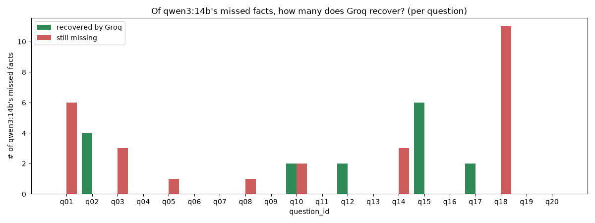

# Groq converter check — report

## Purpose

Same 20 agent answers as `../runs/20261102_125528/answers.jsonl` (qwen3:14b agent, unchanged), same schema.yaml/few_shot.json, same prompt — only the converter model changes, from qwen3:14b (Ollama) to `openai/gpt-oss-120b` (Groq). Checks how many of the 43 facts qwen3:14b's converter missed (`missed_facts.csv`, manually annotated) a stronger model catches.

## Automatic metrics (Groq converter pass)

- Answers converted: 20
- Parse success rate: 1.0
- Total relationships extracted: 201 (qwen3:14b extracted 234 on the same answers)
- Converter latency (s): {'mean': 12.286, 'min': 2.811, 'max': 24.047}

## SHACL (structural, per-question — fully automatic, no annotation needed)

- Violations: 0
- Warnings: 6
- Full detail: `shacl_check.txt`

## Missed-facts recovery, by relation type

| relation | total missed (qwen) | caught by Groq | recall |
|---|---|---|---|
| associatedWith | 19 | 14 | 0.737 |
| binds | 24 | 2 | 0.083 |
| **all** | **43** | **16** | **0.372** |

**Reading this**: a high recall for a relation type means qwen3:14b's misses on that relation are mostly a *model-strength* limitation (a stronger model fixes them on the same text/prompt). A low recall means the misses persist regardless of model — more likely a prompt/schema/task limitation than a qwen3:14b weakness specifically.

## Caught by Groq (heuristic name match — verify manually before citing)

- q02: TP53 associatedWith breast cancer
- q02: PTEN associatedWith breast cancer
- q02: BRCA1 associatedWith ovarian cancer
- q02: BRCA2 associatedWith ovarian cancer
- q10: adalimumab binds TNF
- q10: etanercept binds TNF
- q12: FBXO7 associatedWith Parkinson's disease
- q12: ATP13A3 associatedWith Parkinson's disease (λάθος της απάντησης: το PARK9 είναι ATP13A2)
- q15: APC associatedWith colorectal cancer
- q15: MLH1 associatedWith colorectal cancer
- q15: MSH2 associatedWith colorectal cancer
- q15: MSH6 associatedWith colorectal cancer
- q15: PMS2 associatedWith colorectal cancer
- q15: EPCAM associatedWith colorectal cancer
- q17: BRCA2 associatedWith breast cancer
- q17: BRCA2 associatedWith ovarian cancer

## Still missing with Groq too

- q01: glipizide binds KATP channel
- q01: sitagliptin binds DPP4
- q01: empagliflozin binds SLC5A2
- q01: liraglutide binds GLP1R
- q01: acarbose binds alpha-glucosidase
- q01: repaglinide binds KATP channel
- q03: BCR-ABL associatedWith chronic myeloid leukemia
- q03: KIT associatedWith gastrointestinal stromal tumors
- q03: PDGFRA associatedWith gastrointestinal stromal tumors
- q05: BCR-ABL associatedWith chronic myeloid leukemia
- q08: EGFR associatedWith non-small cell lung cancer
- q10: tocilizumab binds IL6R
- q10: tofacitinib binds JAK
- q14: omalizumab binds IgE
- q14: mepolizumab binds IL5
- q14: dupilumab binds IL4R
- q18: lamotrigine binds Nav1.1
- q18: lamotrigine binds Nav1.2
- q18: lamotrigine binds Nav1.3
- q18: oxcarbazepine binds Nav1.1
- q18: oxcarbazepine binds Nav1.2
- q18: oxcarbazepine binds Nav1.3
- q18: diazepam binds GABA-A receptor
- q18: lorazepam binds GABA-A receptor
- q18: phenobarbital binds GABA-A receptor
- q18: perampanel binds AMPA receptor
- q18: topiramate binds AMPA/kainate receptor

## Note on annotation.csv/missed_facts.csv

Written as empty templates (same format as exp1's). Filling them in would let us compute this run's own precision and SHACL-catch-rate confusion matrix, same as exp1's report — not done here since it needs a fresh human read of all 20 answers against Groq's own extractions, which is separate work from the missed-facts recovery check above.