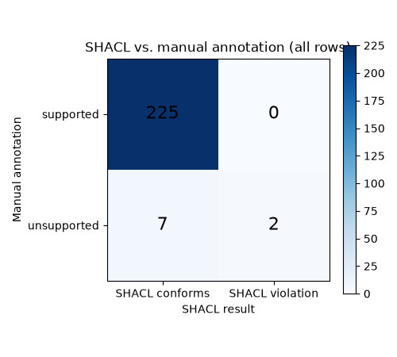
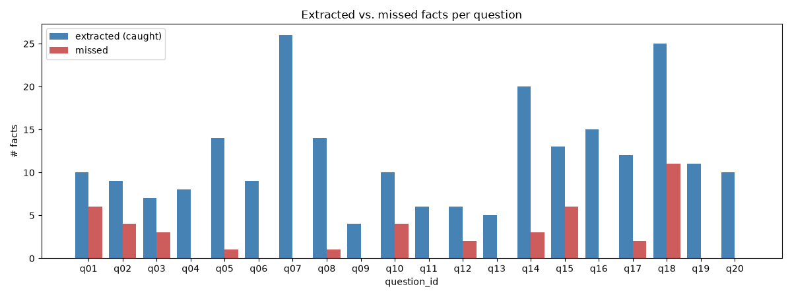

# Experiment 1 Report: Agent Answer -> RDF

## Automatic metrics

- Answers evaluated: 20
- Converter JSON parse success rate: 1.0
- JSON-schema-valid rate: 1.0
- Domain/range correctness rate: 0.991
- Dangling references: 0
- Duplicate nodes: 0
- Turtle round-trip parse success rate: 1.0
- Nodes per answer: {'mean': 11.6, 'min': 5, 'max': 25}
- Triples per answer: {'mean': 11.7, 'min': 4, 'max': 26}
- Relation counts: {'binds': 60, 'treats': 96, 'associatedWith': 54, 'interactsWith': 24}
- % answers with zero extracted relationships: 0.0
- Agent latency (s): {'mean': 14.711, 'min': 7.65, 'max': 92.586}
- Converter latency (s): {'mean': 10.324, 'min': 3.655, 'max': 31.126}
- Subject hallucination rate (Text2KGBench SH): 0.004
- Object hallucination rate (Text2KGBench OH): 0.047

## Failures

- none

## Manual annotation (annotation.csv)

- Precision: 0.962 (225/234)
- Unsupported triples: 9
  - q05: omacetaxine mepesuccinate binds BCR-ABL — Γεγονός: ΛΑΘΟΣ. Το κείμενο δεν το παρουσιάζει ως TKI ούτε λέει ότι στοχεύει το BCR-ABL. Το omacetaxine αναστέλλει τη σύνθεση πρωτεϊνών στο ριβόσωμα.
  - q14: omalizumab binds CHRM3 — Γεγονός: ΛΑΘΟΣ. Σφάλμα εξαγωγής: το κείμενο λέει «IgE inhibitor». Το CHRM3 φαίνεται να αντιγράφηκε από το tiotropium.
  - q14: mepolizumab binds CHRM3 — Γεγονός: ΛΑΘΟΣ. Σφάλμα εξαγωγής: το κείμενο λέει «IL-5 inhibitor».
  - q14: dupilumab binds CHRM3 — Γεγονός: ΛΑΘΟΣ. Σφάλμα εξαγωγής: το κείμενο λέει «IL-4/IL-13 receptor antagonist» (IL4R).
  - q17: breast cancer associatedWith hereditary cancer syndromes — Γεγονός: αμφίβολο. Τύποι Disease→Disease (η σχέση θέλει Gene→Disease). Το κείμενο λέει ότι μεταλλάξεις του BRCA2 συνδέονται με κληρονομικά σύνδρομα, όχι ότι η νόσος συνδέεται με αυτά. Το «hereditary cancer syndromes» είναι επίσης πολύ γενικό. Σωστή τριάδα: BRCA2 associatedWith breast cancer.
  - q17: ovarian cancer associatedWith hereditary cancer syndromes — Γεγονός: αμφίβολο. Τύποι Disease→Disease (η σχέση θέλει Gene→Disease). Το κείμενο λέει ότι μεταλλάξεις του BRCA2 συνδέονται με κληρονομικά σύνδρομα, όχι ότι η νόσος συνδέεται με αυτά. Το «hereditary cancer syndromes» είναι επίσης πολύ γενικό. Σωστή τριάδα: BRCA2 associatedWith ovarian cancer.
  - q20: aspirin treats heart attack — Γεγονός: σωστό. Το κείμενο μιλά για πρόληψη («cardiovascular protection in patients at risk»), όχι θεραπεία. Η ασπιρίνη πάντως χορηγείται και στο οξύ έμφραγμα.
  - q20: aspirin treats stroke — Γεγονός: αμφίβολο. Το κείμενο μιλά για πρόληψη. Ισχύει για ισχαιμικό επεισόδιο· αντενδείκνυται στο αιμορραγικό.
  - q20: aspirin treats colorectal cancer — Γεγονός: ΛΑΘΟΣ. Το κείμενο λέει «prevent». Η ασπιρίνη μελετάται για χημειοπροφύλαξη, δεν θεραπεύει τον καρκίνο.

## SHACL catch rate (of the unsupported triples above)

- Caught structurally by SHACL: 2/9 (0.222)
- NOT caught (needs fact-check, structurally valid): 7/9

- Confusion matrix (all annotation.csv rows): TN=225 FP=0 FN=7 TP=2

  - q05: omacetaxine mepesuccinate binds BCR-ABL
  - q14: omalizumab binds CHRM3
  - q14: mepolizumab binds CHRM3
  - q14: dupilumab binds CHRM3
  - q20: aspirin treats heart attack
  - q20: aspirin treats stroke
  - q20: aspirin treats colorectal cancer

## Missed facts (missed_facts.csv)

- Extracted relationships: 234
- Missed facts: 43
- Recall ≈ extracted / (extracted + missed): 0.845
- Questions with missed facts: 11
  - q01: glipizide binds KATP channel; sitagliptin binds DPP4; empagliflozin binds SLC5A2; liraglutide binds GLP1R; acarbose binds alpha-glucosidase; repaglinide binds KATP channel
  - q02: TP53 associatedWith breast cancer; PTEN associatedWith breast cancer; BRCA1 associatedWith ovarian cancer; BRCA2 associatedWith ovarian cancer
  - q03: BCR-ABL associatedWith chronic myeloid leukemia; KIT associatedWith gastrointestinal stromal tumors; PDGFRA associatedWith gastrointestinal stromal tumors
  - q05: BCR-ABL associatedWith chronic myeloid leukemia
  - q08: EGFR associatedWith non-small cell lung cancer
  - q10: adalimumab binds TNF; etanercept binds TNF; tocilizumab binds IL6R; tofacitinib binds JAK
  - q12: FBXO7 associatedWith Parkinson's disease; ATP13A3 associatedWith Parkinson's disease (λάθος της απάντησης: το PARK9 είναι ATP13A2)
  - q14: omalizumab binds IgE; mepolizumab binds IL5; dupilumab binds IL4R
  - q15: APC associatedWith colorectal cancer; MLH1 associatedWith colorectal cancer; MSH2 associatedWith colorectal cancer; MSH6 associatedWith colorectal cancer; PMS2 associatedWith colorectal cancer; EPCAM associatedWith colorectal cancer
  - q17: BRCA2 associatedWith breast cancer; BRCA2 associatedWith ovarian cancer
  - q18: lamotrigine binds Nav1.1; lamotrigine binds Nav1.2; lamotrigine binds Nav1.3; oxcarbazepine binds Nav1.1; oxcarbazepine binds Nav1.2; oxcarbazepine binds Nav1.3; diazepam binds GABA-A receptor; lorazepam binds GABA-A receptor; phenobarbital binds GABA-A receptor; perampanel binds AMPA receptor; topiramate binds AMPA/kainate receptor

